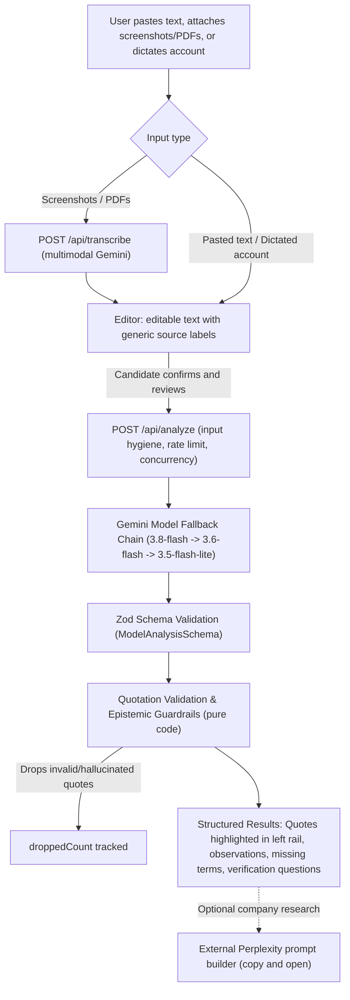

# OfferClara

> **Understand the offer. Know what to verify. Make every offer clear.**

A free, no-sign-in review assistant that helps students and first-time job seekers read an internship or job offer carefully before they pay money or share documents.

- **Live Project:** [offerclara-wisprflow.vercel.app](https://offerclara-wisprflow.vercel.app/)
- **GitHub Repository:** [github.com/nilesh0199/OfferClara-WisprFlow-Hackathon](https://github.com/nilesh0199/OfferClara-WisprFlow-Hackathon)
- **Demo Video:** [youtu.be/uXINb5E6vwg](https://youtu.be/uXINb5E6vwg)
- **Dev.to Article:** [Before you pay for that internship: Building OfferClara with Wispr Flow](https://dev.to/nileshthipe/before-you-pay-for-that-internship-building-offerclara-with-wispr-flow-no-2n3e)
- **Hackathon:** [No Hands: The Wispr Challenge by WeMakeDevs & Wispr Flow](https://www.wemakedevs.org/wispr)
- **Connect on LinkedIn:** [Nilesh Thipe](https://www.linkedin.com/in/nilesh-h-thipe-372291253/)
- **Routes:** `/` (landing page and overview) · `/check` (review workspace) · `/resources` (official verification portals and reporting channels) · `/privacy` (privacy notice and data handling practices) · `/about` (about OfferClara) · `/ask` (clear doubt with AI)

---

## The Problem

When you are starting out, an offer can feel like a rare chance, and normal hiring practices may be unfamiliar. Scam messages are built around that moment: an upfront registration or training fee, a "refundable" security deposit, an urgent request for identity or bank documents, and a tight deadline to create pressure.

Official advisories in India state that genuine internship and job services do not charge applicants (see the AICTE National Internship Portal and National Career Service advisories documented in [docs/resources-verification.md](docs/resources-verification.md)). OfferClara gives candidates a calm second look: it points out the exact lines worth questioning, lists what the communication does not say, and drafts questions to ask before paying money or sharing personal credentials.

---

## Who It Is For and How a Review Works

OfferClara is built for students and first-time job seekers receiving internship or entry-level job solicitations via email, messaging apps, job boards, or phone calls.

A review works in five structured steps:

1. **Step 1 — Offer text and documents:** Paste offer text, attach up to 5 screenshots or PDFs (max 4 MB total), or load sample offers. Text from files is transcribed and appended below existing text with generic source labels, fully editable with one-click undo.
2. **Step 2 — Source and channel:** Specify how the offer was received (email, LinkedIn, WhatsApp, Telegram, campus, or job portal) and whether an application was submitted.
3. **Step 3 — Described conversation:** Describe recruiter phone calls, verbal promises, or interview details in your own words (typed or dictated).
4. **Step 4 — Money and documents:** Note any requested training fees, security deposits, equipment charges, or sensitive identity documents.
5. **Step 5 — Review and submit:** Inspect the structured summary, review the interactive visual preview with client-side privacy masking (scrubs names, phone numbers, emails, Aadhaar, and PAN directly on your device), review AI data notices, and launch the evidence-linked review.

---

## What Makes It Different

- **Deterministic quote validation:** Every potential concern cites an exact verbatim quote that code verifies against the candidate's text before rendering. If the model hallucinates, alters, or truncates a quote, the concern is discarded by code and counted in `droppedCount`. The model is never trusted for evidence.
- **Separation of observations and gaps:** What the message explicitly says is kept strictly separate from foundational employment terms that are absent.
- **No scores or verdicts:** The tool never issues numeric risk scores, percentages, or binary verdict badges ("safe", "verified", "legit", "scam", or "fraud").
- **Stated limits:** Every review includes immutable limits explaining what the tool cannot know (it cannot verify sender identity, corporate incorporation, or off-document oral promises).
- **External research handoff:** Rather than claiming to verify company legitimacy in-app, the tool prepares a structured search prompt that candidates can copy to Perplexity to research company presence independently.
- **Docked Command Box (Navigation Only):** Docked input (`Dictate a command`) with an optional toggle (top bar and sidebar), status dot, active green glow, `What can I say?` dialog, Spacebar cancellation, and a 1-second countdown for hands-free site navigation without requiring microphone permissions.
- **Clear Doubt with AI (`/ask`):** A focused, full-height chat interface with docked composer, auto-growing input, example question starter cards, right-aligned bubbles, left-aligned answer cards, and question-aware deterministic fallback with zero employer generalizations.

---

## Features

| Feature | Status | Notes |
| :--- | :--- | :--- |
| **5-step review wizard** | Implemented | Step-by-step guidance separating offer documents, source channel, candidate-described conversations, payment/document requests, and review snapshot at `/check`. Header row includes a "Clear and start over" ghost button. |
| **Client-side privacy masking** | Implemented | Step 5 interactive visual preview and regex scrubber that detects personal identifiers (candidate names, phone numbers, emails, Aadhaar numbers, PAN cards, UPI IDs, bank accounts) on-device, offering 1-click batch masking and individual toggle pills before sending text to the AI. |
| **Combined text & file review** | Implemented | Evaluates combined text up to 12,000 characters; up to 5 screenshots (PNG, JPEG, WebP) or PDFs (max 4 MB total) transcribed via Gemini multimodal API and appended with generic source markers (`---- Text from Screenshot N ----`, `---- Text from PDF N ----`) and 1-level undo. |
| **Docked Command Box** | Implemented | Docked bottom bar with placeholder `Dictate a command`, optional top bar/sidebar toggle, active green glow, `What can I say?` dialog, Spacebar cancellation, 1-second countdown, and dynamic `--dock-offset` preventing viewport overlap. |
| **Clear doubt with AI** | Implemented | Focused full-height chat interface at `/ask` with docked bottom composer, auto-growing textarea, IME guards, 2x2 starter questions, calm text-only loading state, and question-aware deterministic fallback with zero employer generalizations. |
| **Master-detail results layout** | Implemented | 3 desktop columns: left rail `ResultsNav` with live scroll-spy, middle fluid `AnalysisResults`, and right rail `YourOfferWorkspace` document viewer with line numbers and quote highlights. |
| **Review actions & export** | Implemented | `ResultsActionsBar` with print-ready PDF export (dynamic title `OfferClara review YYYY-MM-DD`), markdown summary clipboard copy, Web Share API, and native `<dialog id="clear-review-dialog">` clear confirmation. |
| **Call or conversation descriptions** | Implemented | Candidates can type or dictate an account of a phone call or verbal interaction in their own words; reviewed with a dedicated review limit acknowledging candidate descriptions. |
| **Observations with line numbers and highlights** | Implemented | Document viewer with line numbers and quote highlights; bi-directional linking between observation cards and text lines. |
| **Missing details table** | Implemented | Foundational contractual terms (compensation, roles, working hours, workplace location) displayed in a compact 2-column table (`Topic \| Note`), kept separate from concerns. |
| **Verification questions** | Implemented | Suggested questions drafted to clarify ambiguous terms, with one-click clipboard copying. |
| **"Check these yourself" steps** | Implemented | Contextually prioritised verification steps based on identified concerns (payment, sensitive data, off-platform messaging). |
| **Official institutional advisories** | Implemented | Contextually matched verified notices from IIT Bhubaneswar, St. Xavier's College Jaipur placement cell, and Careers360 / IIT Roorkee report. |
| **Help, reporting and official resources** | Implemented | Static `/resources` page ("Help and reporting") with verified links and helpline numbers for AICTE, NCS (1514), MCA Company Search, and the National Cyber Crime Reporting Portal (1930). Section `#already-paid` for urgent steps. Zero runtime network calls. |
| **Company research prompt for Perplexity** | Implemented | Prepares a structured search prompt with confirmed company details, depth switcher, and direct link to Perplexity. No in-app search API or web scraping. |
| **Light, dark, and system theme** | Implemented | Ink Blue dual-theme palette with navy header bar, WCAG 2.1 AA/AAA contrast, anti-FOUC script, and accessible segmented `ThemeToggle`. |
| **Static landing page** | Implemented | Fast static landing page at `/` with static annotated paper card, 5 wizard steps overview, command bar preview, capabilities comparison, dual-column FAQ, and WeMakeDevs x Wispr Flow attribution. |
| **Privacy page** | Implemented | Dedicated static `/privacy` route detailing ephemeral tab-memory processing, zero database retention, free-tier Google AI disclosures, and client-side sensitive identifier warnings. |
| **Safeguards** | Implemented | In-memory sliding-window rate limiting (8/15m, 30/24h for analysis; 6/15m, 20/24h for uploads) with salted SHA-256 IP hashing, model circuit breaker, in-memory concurrency guard (max 4), input hygiene (blocking NUL/control characters), normative hiring word prohibition, and security headers. |
| **Job-offer coverage** | Partially implemented | The review prompt treats salary, probation period, joining date and contract terms as missing details when unstated, and display labels say "Stipend or salary" and "Duration or contract term". There are no job-offer sample texts and no job-offer evaluation yet; clauses such as service bonds or training-fee agreements are not specifically handled. |

---

<details>
<summary><strong>How It Works (Technical Architecture)</strong></summary>

### Technical Flow



### Core Architectural Decisions

1. **The model is never trusted for evidence:** LLMs generate plausible observations, but every quoted substring is deterministically verified against the input text by pure application code. Hallucinated, truncated, or modified quotes are purged before rendering.
2. **Session state lives in volatile browser RAM:** Active text, uploaded files, and review results are managed via React Context (`SessionProvider`) and a pure reducer in memory. State survives navigation between `/`, `/check`, `/resources`, and `/privacy` without writing to `localStorage`, `sessionStorage`, or cookies. Refreshing or closing the tab immediately clears the data.
3. **Zero database persistence:** There are no user accounts, no saved offer histories, no cookies, and no tracking databases. Uploaded files exist in server memory only during the active transcription request and are never written to disk or object storage.

</details>

---

<details>
<summary><strong>Privacy and Responsible Use</strong></summary>

### Client-Side Privacy Masking & Sensitive Data Scrubbing

Before submitting offer text or conversation transcripts to upstream models, Step 5 (Review & Submit) runs pure client-side regex detection on your device. It detects phone numbers, personal email addresses, Aadhaar numbers, PAN cards, UPI IDs, bank account runs, and candidate names. Users can preview detected tokens with interactive visual toggle pills, batch-redact or keep items, and ensure personal data is replaced with generic placeholders (`[PHONE_REDACTED]`, `[EMAIL_REDACTED]`, `[AADHAAR_REDACTED]`, `[PAN_REDACTED]`, `[UPI_REDACTED]`, `[CANDIDATE_NAME]`) with zero server or AI calls.

### What Is Sent to External Services

When candidates submit text or upload files for review, they are transmitted over HTTPS to Google's Gemini API on the free tier. Above the input area and in the privacy policy, OfferClara presents the verbatim notice:

> "The text you submit is sent to Google's Gemini API for analysis. OfferClara uses Google's free tier, where Google states that submitted content may be used to improve its products. Do not submit anything you would not want processed this way."

For file uploads, anything visible in an uploaded screenshot or PDF is processed by Gemini's multimodal API solely to transcribe text. Original file names are never sent to Google, never logged, and never included in transcripts; appended text blocks use generic labels (`---- Text from Screenshot N ----`, `---- Text from PDF N ----`).

### What Is Not Stored

- **No databases or user accounts:** No sign-in, authentication tokens, or profile storage.
- **No disk storage:** Offer text, file uploads, and transcripts are never saved to server disk or cloud object storage.
- **No third-party analytics:** No tracking pixels, marketing scripts, or external telemetry libraries are loaded.
- **Clean server logs:** Server logs record only operational metadata (status codes, durations, byte counts). Server logs never contain offer text, file names, transcripts, or personal credentials.

### What Stays in Your Browser

- Offer text, attached files, and review findings exist only in the active browser tab's volatile memory.
- The user's theme selection (light, dark, or system preference) is the sole item stored in browser storage (`localStorage` key `"offercheck-theme"`).

### Rate Limiting Privacy

Rate limiting operates via an in-memory sliding window using salted SHA-256 IP hashes. The IP address is combined with a random 16-byte salt generated when the server boots. Raw IP addresses are never logged or persisted.

For complete policy details, see [docs/privacy-and-responsible-use.md](docs/privacy-and-responsible-use.md) and the live `/privacy` route.

</details>

---

## Limitations

- **Free-tier API quotas:** OfferClara operates on Google's Gemini API free tier. Saturated upstream rate limits return clean HTTP 429 responses with retry advisories.
- **Serverless in-memory scope:** Rate limits, concurrency controls, and circuit breakers operate in-memory on the active serverless instance; state is not shared across multi-instance serverless deployments.
- **Model errors and OCR mistakes:** Language models can misinterpret atypical arrangements or generate invalid quotes (which code drops). Transcription of low-resolution screenshots may contain OCR errors.
- **Candidate-described verbal accounts:** When evaluating user-typed or dictated descriptions of calls or verbal conversations, the review reflects the candidate's description, not an original document or recording.
- **English only:** System instructions, schemas, and synthetic examples are designed exclusively for English-language communications.
- **Cannot verify identity or authority:** The tool analyzes text content only. It cannot verify whether an email address is spoofed or whether a sender actually works for the organisation they claim to represent.
- **Not legal advice:** All findings, missing-item checklists, and questions are informational prompts for self-advocacy and due diligence, not legal counsel.

---

<details>
<summary><strong>Tech Stack and Project Structure</strong></summary>

### Technologies Used

- **Framework:** Next.js 16 (App Router, Turbopack)
- **Language:** TypeScript 5
- **UI & Styling:** React 19, Tailwind CSS v4, custom semantic CSS tokens
- **AI SDK:** `@google/genai` (Interactions API with model fallback chain)
- **Validation:** Zod 4
- **Typography:** `next/font/google` (`IBM Plex Sans`, `IBM Plex Mono`, `Newsreader`)
- **Testing:** Vitest
- **Hosting:** Vercel

### Project Structure

```text
OfferClara/
├── docs/             # Specifications, design briefs, test plans, verified resources, and development logs
├── public/           # Static public assets (SVGs, web manifest)
├── src/
│   ├── app/          # Next.js App Router pages (/, /check, /resources, /privacy) and API route handlers
│   ├── components/   # React components (input form, workspaces, viewers, landing page, uploaders)
│   ├── data/         # Static verified resources, contextual self-checks, and synthetic examples
│   └── lib/          # Analysis pipeline, Gemini wrapper, quote validator, rate limiting, and upload helpers
├── tests/            # Automated offline unit and integration tests (Vitest)
└── tests-live/       # Live Gemini API evaluation tests (requires GEMINI_API_KEY)
```

</details>

---

<details>
<summary><strong>Getting Started</strong></summary>

### Prerequisites

- Node.js 20 or higher
- npm

### Installation

1. Clone the repository:
   ```bash
   git clone https://github.com/nilesh0199/OfferClara-WisprFlow-Hackathon.git
   cd OfferClara-WisprFlow-Hackathon
   ```

2. Install dependencies:
   ```bash
   npm install
   ```

3. Configure environment variables:
   Copy `.env.example` to `.env.local` and add your Google Gemini API key:
   ```bash
   cp .env.example .env.local
   ```

### Environment Variables

| Variable | Description |
| :--- | :--- |
| `GEMINI_API_KEY` | Required server-side Google Gemini API key from Google AI Studio. |
| `GROQ_API_KEY` | Optional server-side Groq API key for review fallback chain and clear doubt helper. |
| `GROQ_MODEL` | Optional Groq model override (default: `openai/gpt-oss-120b`). |
| `GEMINI_MODELS` | Optional comma-separated model fallback chain (default: `gemini-3.8-flash,gemini-3.6-flash,gemini-3.5-flash-lite`, max 3). |
| `GEMINI_MODEL` | Optional legacy single-model override (used only if `GEMINI_MODELS` is unset). |
| `GEMINI_THINKING_LEVEL` | Optional thinking level override (`low`, `minimal`, `medium`, `high`). |
| `RATE_LIMIT_PER_WINDOW` | Optional maximum analyses per 15-minute window (default: 8). |
| `RATE_LIMIT_PER_DAY` | Optional maximum analyses per 24-hour day (default: 30). |
| `TRANSCRIBE_LIMIT_PER_WINDOW` | Optional maximum transcriptions per 15-minute window (default: 6). |
| `TRANSCRIBE_LIMIT_PER_DAY` | Optional maximum transcriptions per 24-hour day (default: 20). |
| `ASK_LIMIT_PER_WINDOW` | Optional maximum doubt questions per 15-minute window (default: 10). |
| `ASK_LIMIT_PER_DAY` | Optional maximum doubt questions per 24-hour day (default: 40). |
| `NEXT_PUBLIC_SITE_URL` | Optional public site URL for OpenGraph metadata resolution. |

### Development Scripts

- `npm run dev`: Start local development server at `http://localhost:3000`.
- `npm run build`: Build production application with Turbopack.
- `npm start`: Start local production server after build.
- `npm test`: Run complete offline Vitest test suite.
- `npm run test:live`: Run live Gemini API evaluation suite (requires `GEMINI_API_KEY`).
- `npm run lint`: Run ESLint checks.
- `npm run typecheck`: Run TypeScript compiler type checking (`tsc --noEmit`).

### Deployment

OfferClara is configured for zero-configuration deployment on Vercel. Set `GEMINI_API_KEY` in the Vercel project environment variables. No external database or persistent storage setup is required.

</details>

---

<details>
<summary><strong>Testing and Evaluation</strong></summary>

### Offline Test Suite

The test suite runs completely offline with zero network calls and mock client injection (477 tests passing across 49 test files as of 24 Oct 2026):
```bash
npm test
```

The offline test suite validates:
- 5-step wizard workflow and pure session reducer state transitions.
- Global Command Bar natural language matching across 80+ patterns and conversational filler stripping.
- Institutional advisories pure matching against offer context and payment requests.
- Deterministic quote validation (Unicode grapheme handling, exact substring search, nested quote containment, and duplicate deduplication).
- Epistemic overclaiming guardrails and tone compliance.
- Zod schema validation and model output parsing.
- Model fallback chain, shared 55s deadline, and 20s per-attempt timeout cap.
- Sliding-window rate limiter, memory caps, and eviction logic.
- Model circuit breaker with tiered cooldowns and fail-open resilience.
- In-memory concurrency guard with guaranteed decrement.
- Input hygiene (blocking NUL characters and unprintable control characters).
- Binary file upload inspection, magic bytes, and canvas downscaling constraints.
- Generic source marker formatting and line numbering.
- Company research prompt builder and raw offer text exclusion.
- Contextual prioritization for self-checks and official resources.
- Dual-theme token architecture and WCAG 2.1 AA/AAA contrast ratios.
- Typographic rem scale enforcement and 0.875rem floor.
- Safe logging audit verifying zero offer text or API key leakage in server logs.

### Live API Tests

To test the pipeline against Google Gemini's API using the synthetic examples, combined inputs, and prompt-injection fixtures:
```bash
npm run test:live
```
*(Requires `GEMINI_API_KEY` in `.env.local`. If the key is absent, the suite cleanly skips with an explanatory message. Live calls consume free-tier quota).*

### Benchmark Evaluation Set

The evaluation dataset consists of five synthetic examples and one adversarial prompt-injection fixture. The benchmark cases, target behaviors, and verification matrices are documented in [docs/evaluation-set.md](docs/evaluation-set.md). The live-result column in that matrix is populated by the evaluator during live model test runs.

</details>

---

## Building with Wispr Flow — No Hands: The Wispr Challenge

This project was built for **[No Hands: The Wispr Challenge](https://www.wemakedevs.org/wispr)**, organised by **WeMakeDevs** and **Wispr Flow**.

The challenge encouraged builders to use their voice throughout the building process: describing requirements, prompting coding assistants, writing documentation, and communicating as they worked.

Rather than treating Wispr Flow as something to demonstrate only at the very end, I integrated it directly into my regular development workflow from day one.

### 1. Speaking My Development Prompts
While building OfferClara, I used Wispr Flow to dictate prompts and follow-up instructions into my AI coding workflow.

When developing a feature, I often needed to explain several interconnected details together:
- What the interface should look like and how it should behave.
- How candidates move through each step of the review flow.
- What edge cases to guard against (such as oversized inputs or unverified quotes).
- Which existing architectural boundaries, color palettes, and design tokens must not be touched.

Speaking those requirements felt significantly more natural and convenient than typing every single sentence manually. I could explain the intended behavior in clear, natural language, quickly review the dictated transcription, and send it directly to my coding assistant.

Wispr Flow handled the voice dictation with high accuracy. The coding tool handled the implementation, and I reviewed the code diffs, tested the features, and verified the application. That distinction is important: Wispr Flow didn't build the project by itself; it fundamentally improved how I communicated what I wanted to build.

### 2. Testing with Realistic Offer Text & Clear Doubt
Another valuable application came during testing.

OfferClara depends entirely on the text a candidate provides, so I needed to test realistic, imperfect inputs rather than only tidy, pre-formatted synthetic examples. I used Wispr Flow to dictate messy offer communications, phone call accounts, and recruiter messages directly into the application inputs.

This allowed me to experience the intake workflow from a real user's perspective: speak or paste the information, review the structured summaries, edit details if necessary, and launch the analysis.

I also experimented with dictating questions into the **Clear Doubt with AI (`/ask`)** feature. A student who has received a confusing or suspicious job offer is often stressed and wants to explain an ambiguous phone call in their own words or ask a quick question without meticulously composing every phrase. Speaking those scenarios helped ensure the interaction felt intuitive and supportive.

### 3. Inviting Friends to Test
I also wanted peers and fellow students to try OfferClara rather than relying solely on my own testing.

I used Wispr Flow to dictate and draft the outreach messages inviting friends to test the live application and share their feedback. It was a simple task, but another practical demonstration of voice input outside the core code editor.

### Key Takeaway
Across all these activities, voice input proved faster and more convenient for me than typing everything by hand. I was impressed by how accurately Wispr Flow captured technical context and natural phrasing, and I ended up using it far more than I initially expected.

The biggest takeaway wasn't that voice input replaces every single keyboard shortcut or code inspection. It was that I could express longer, more nuanced thoughts naturally, get them into the tool I was using without breaking flow, and keep moving forward.

---

## Project Links & Submission

- **Live Project:** [https://offerclara-wisprflow.vercel.app/](https://offerclara-wisprflow.vercel.app/)
- **GitHub Repository:** [https://github.com/nilesh0199/OfferClara-WisprFlow-Hackathon](https://github.com/nilesh0199/OfferClara-WisprFlow-Hackathon)
- **Demo Video:** [https://youtu.be/uXINb5E6vwg](https://youtu.be/uXINb5E6vwg)
- **Dev.to Article:** [Before you pay for that internship: Building OfferClara with Wispr Flow](https://dev.to/nileshthipe/before-you-pay-for-that-internship-building-offerclara-with-wispr-flow-no-2n3e)
- **Hackathon Details:** [No Hands: The Wispr Challenge by WeMakeDevs & Wispr Flow](https://www.wemakedevs.org/wispr)
- **Connect on LinkedIn:** [Nilesh Thipe](https://www.linkedin.com/in/nilesh-h-thipe-372291253/)

---

## Official Resources and Acknowledgements

OfferClara references official Indian statutory portals and reporting helplines:

- [National Cyber Crime Reporting Portal](https://cybercrime.gov.in) (`cybercrime.gov.in`) — 24/7 National Cyber Financial Fraud Helpline: **1930**
- [AICTE National Internship Portal](https://internship.aicte-india.org) (`internship.aicte-india.org`) — Free student internship services and reporting (`internship@aicte-india.org`)
- [National Career Service (NCS)](https://www.ncs.gov.in) (`ncs.gov.in`) — Ministry of Labour and Employment, Toll-free helpline: **1514**
- [Ministry of Corporate Affairs (MCA) Company / LLP Search](https://www.mca.gov.in/content/mca/global/en/mca/fo-llp-services/company-llp-name-search.html) (`mca.gov.in`) — Official public search for registered Indian companies and LLPs

*(For verification details and date of verification, see [docs/resources-verification.md](docs/resources-verification.md)).*

---

## Roadmap

Planned future enhancements (not yet implemented in the codebase):

- **Job-offer evaluation benchmarks:** Adding dedicated job-offer sample communications and expanding evaluation criteria for full-time employment terms.
- **Contractual clause handling:** Specific detection and guidance for employment-specific clauses such as training-fee agreements and service bonds.
- **In-browser image redaction:** Client-side blur and crop tools directly inside the browser upload zone before transmission.
- **Multilingual guidance:** Translating official resource guidance and verification questions into regional Indian languages.

---

*Built solo for **No Hands: The Wispr Challenge** (WeMakeDevs x Wispr Flow), Builders track.*
